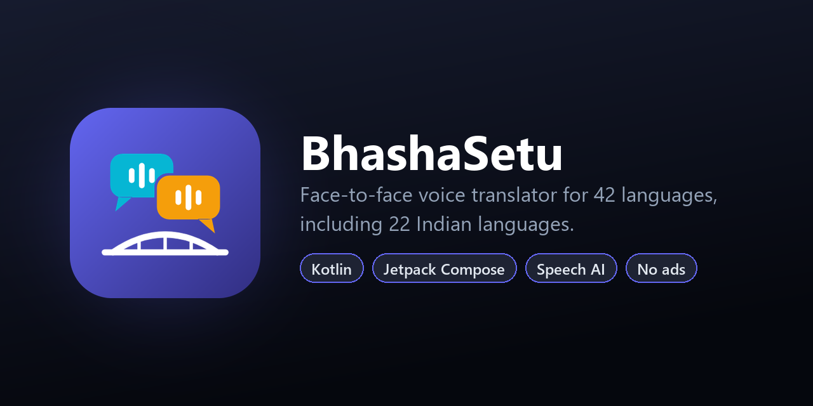

<p align="center">
  
</p>

<p align="center">
  <a href="https://github.com/souvik-das-tech/BhashaSetu-Android/releases/latest"></a>
  
  
  
  
  
</p>

# BhashaSetu

**BhashaSetu** (*bhasha* = language, *setu* = bridge) lets two people who share no language
talk face to face with one phone between them. Each person speaks or types in their own
language. The app shows what was said, translates it, and reads the translation aloud in the
other person's language.

It covers **42 languages**: 22 Indian languages (all of the scheduled languages that Google
Translate supports, plus Bhojpuri) and 20 widely spoken languages from around the world.

> This is the native **Kotlin + Jetpack Compose** edition. A separate, fully on-device Flutter
> edition with 6 languages lives at [BhashaSetu_Offline](https://github.com/souvik-das-tech/BhashaSetu_Offline).

## Download

Get the latest APK from **[Releases](https://github.com/souvik-das-tech/BhashaSetu-Android/releases/latest)**
(Android 8.0 or newer).

## Features

- **Face-to-face split screen.** The top half is rotated 180°, so the person across the table
  reads their side the right way up. Each half has its own talk button and colour.
- **42 languages, any pair.** Hindi, Bangla, Telugu, Tamil, Kannada, Malayalam, Marathi,
  Gujarati, Punjabi, Odia, Assamese, Urdu, Nepali, Sanskrit, Maithili, Konkani, Dogri, Sindhi,
  Manipuri (Meitei script), Santali, Bhojpuri, English, and more. Translation goes directly
  between the two languages, without a pivot through English.
- **Speak or type.** Live partial text while someone talks. Languages without voice input
  switch to a keyboard automatically.
- **Natural voices.** Uses the phone's own text-to-speech voices when they exist, and falls back
  to an online voice for languages the phone can't speak.
- **Voice picker.** Listen to every voice the phone has for a language, see whether it works
  offline, and keep the one you like.
- **Right-to-left support** for Urdu, Sindhi, Arabic and Persian.
- **Clear turn-taking.** The mic is never open while the phone is speaking, so the app never
  hears itself. Tap any bubble to replay a translation, or start a new turn to interrupt.
- **Localised UI.** The app's own messages are translated into each speaker's language.
- **No accounts, no analytics, no ads, and no API keys.**

## How it works

```
 [Mic] ─► Speech-to-text ─► Translate (A → B) ─► Text-to-speech ─► [Speaker]
            │ live partial text      │ both texts shown          │ phone voice, or online voice
            ▼                        ▼                           ▼
       Recognizer.kt           Translator.kt                Speaker.kt
```

| Stage | Implementation |
| --- | --- |
| Speech-to-text | Android `SpeechRecognizer` (Google's recognizer), with live partial results |
| Translation | Several free engines tried in turn: two Google Translate endpoints, then MyMemory as a last resort |
| Text-to-speech | Android `TextToSpeech` with a per-language voice choice, falling back to Google Translate's online voice played via `MediaPlayer` |

Each turn runs as one coroutine: **listen → translate → speak**. A turn counter keeps a late
callback from an interrupted turn from overwriting a newer one.

## Project structure

```
app/src/main/java/com/bbcl/bhashasetu/
├── MainActivity.kt        Entry point, theme colours, mic permission
├── SetupScreen.kt         Language pair picker, per-language capabilities
├── ConversationScreen.kt  Split-screen conversation UI, bubbles, talk buttons
├── VoicePicker.kt         Preview and choose a TTS voice per language
├── Models.kt              App state and the listen → translate → speak turn logic
├── Languages.kt           42 languages with translate / speech codes, RTL flags
├── Recognizer.kt          Coroutine wrapper around SpeechRecognizer
├── Translator.kt          Translation engines with fallback
└── Speaker.kt             Text-to-speech: phone voices and online voice
```

## Tech stack

- **Kotlin 2.4**, **Jetpack Compose** (Material 3), Coroutines
- Android `SpeechRecognizer` and `TextToSpeech`
- No third-party SDKs; networking uses `HttpURLConnection`
- Min SDK 26 (Android 8.0), target SDK 36

## Permissions

| Permission | Why |
| --- | --- |
| `RECORD_AUDIO` | Speech recognition while the talk button is held |
| `INTERNET` | Translation, speech recognition and the online fallback voice |

## Build from source

Requirements: Android Studio (or the Android SDK with platform 36) and JDK 17+.

```bash
git clone https://github.com/souvik-das-tech/BhashaSetu-Android.git
cd BhashaSetu-Android
./gradlew assembleRelease     # app/build/outputs/apk/release/app-release.apk (R8-minified)
./gradlew installDebug        # install a debug build on a connected device
```

The release build is signed with the debug key so it installs out of the box. Add your own
`signingConfig` before publishing to a store.

## License

Released under the [MIT License](LICENSE).

## Author

**Souvik Das** · [GitHub @souvik-das-tech](https://github.com/souvik-das-tech)

If you find this project useful, please consider giving it a ⭐.
